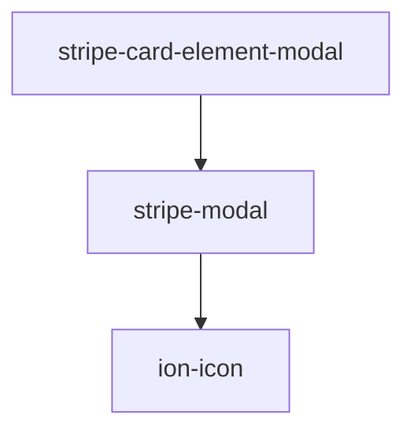

> このページは `src/components/stripe-modal/readme.md` から自動生成されています。

## Accessibility

While open, the modal behaves as a modal dialog:

- The host element gets `role="dialog"` and `aria-modal="true"`.
- Focus moves into the modal (the close button, or the first focusable element) and returns to the previously focused element when it closes.
- `Tab` / `Shift+Tab` cycle through the focusable elements inside the modal.
- Pressing `Escape` closes the modal and emits the `close` event.

Give the dialog an accessible name with `aria-label` or `aria-labelledby` on the host element:

```html
<h2 id="payment-title">Add your payment information</h2>
<stripe-modal aria-labelledby="payment-title"></stripe-modal>
```

Note: key presses inside cross-origin iframes (for example Stripe Elements fields) are not visible to the modal, so `Escape` pressed while such a field has focus does not close it.

<!-- Auto Generated Below -->


## Properties

| Property          | Attribute           | Description                               | Type      | Default |
| ----------------- | ------------------- | ----------------------------------------- | --------- | ------- |
| `open`            | `open`              | Modal state. If true, the modal will open | `boolean` | `false` |
| `showCloseButton` | `show-close-button` | If true, the modal display close button   | `boolean` | `true`  |


## Events

| Event   | Description | Type               |
| ------- | ----------- | ------------------ |
| `close` |             | `CustomEvent<any>` |


## Methods

### `closeModal() => Promise<void>`

Close the modal

#### Returns

Type: `Promise<void>`


### `openModal() => Promise<void>`

Open the modal

#### Returns

Type: `Promise<void>`


### `toggleModal() => Promise<void>`

Toggle modal state

#### Returns

Type: `Promise<void>`


## Dependencies

### Used by

 - [stripe-card-element-modal](../stripe-card-element-modal)

### Depends on

- ion-icon

### Graph


----------------------------------------------

*Built with [StencilJS](https://stenciljs.com/)*
