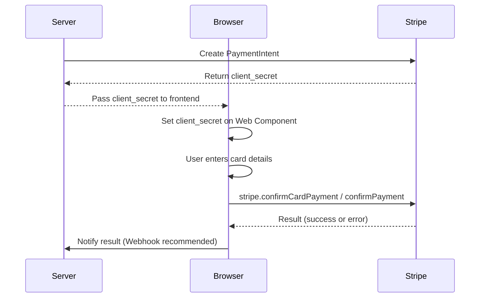
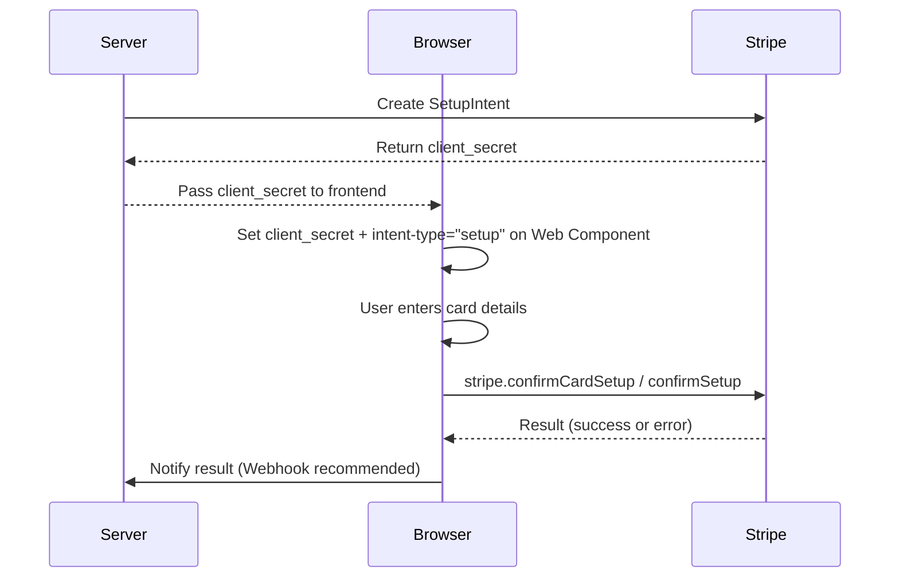
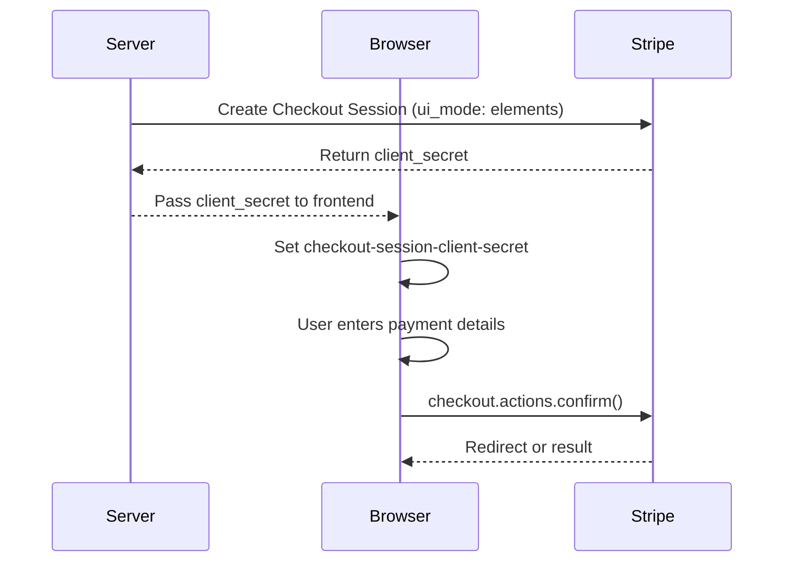
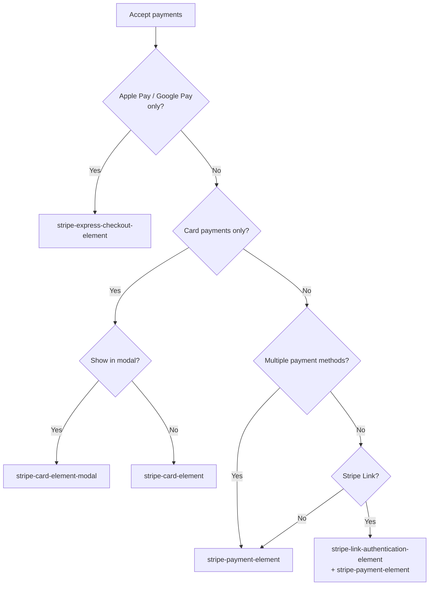

This guide explains the main payment flows used with stripe-pwa-elements.

## PaymentIntent Flow

Use this for immediate payments. Works with `<stripe-card-element>` or `<stripe-payment-element>`.



### Code Example

```html
<stripe-payment-element
  publishable-key="pk_test_xxxxx"
  intent-client-secret="pi_xxxxx_secret_xxxxx"
></stripe-payment-element>
```

```js
const el = document.querySelector('stripe-payment-element');
el.addEventListener('defaultFormSubmitResult', ({ detail }) => {
  if (detail instanceof Error) {
    console.error(detail);
  } else {
    console.log('Success:', detail);
  }
});
```

## SetupIntent Flow

Use this to save card details for future payments. Set `intent-type="setup"`.



### Code Example

```html
<stripe-card-element
  publishable-key="pk_test_xxxxx"
  intent-client-secret="seti_xxxxx_secret_xxxxx"
  intent-type="setup"
></stripe-card-element>
```

## Checkout Session Flow

An integrated payment flow using Stripe Checkout in Elements mode (`ui_mode: 'elements'`). `<stripe-payment-element>` and `<stripe-payment-sheet>` accept a Checkout Session client secret (`cs_xxxxx_secret_xxxxx`).



### Code Example

```html
<stripe-payment-element
  publishable-key="pk_test_xxxxx"
  checkout-session-client-secret="cs_xxxxx_secret_xxxxx"
  checkout-session-return-url="https://example.com/return"
  checkout-session-email="customer@example.com"
></stripe-payment-element>
```

- Setting `checkout-session-client-secret` initializes the component in Checkout Session mode. Do not set it together with `intent-client-secret`.
- The redirect destination is either `return_url` set when the Session was created or `checkout-session-return-url` (the current page URL when omitted) — exactly one is used. When the Session already has `return_url`, the component switches automatically, so both ways of creating the Session work.
- When the Session was created without `customer_email`/`customer`, confirming requires an email address: pass it through `checkout-session-email` (`options.defaultBillingDetails.email` for `<stripe-payment-sheet>`).
- Prefill email or address values with `checkoutSessionDefaultValues` (a JavaScript property). `options.defaultBillingDetails` plays the same role for `<stripe-payment-sheet>`.
- Results arrive through the `checkoutSessionConfirmResult` event (`paymentSheetCompleted` for `<stripe-payment-sheet>`).

```js
const el = document.querySelector('stripe-payment-element');
el.addEventListener('checkoutSessionConfirmResult', ({ detail }) => {
  console.log(detail instanceof Error ? detail.message : detail.type);
});
```

## Component Selection Guide

Choose the right component for your use case.



| Component | Use Case |
| --- | --- |
| `stripe-card-element` | Card-only payments (separate card number, expiry, CVC fields) |
| `stripe-card-element-modal` | Card payments in a modal |
| `stripe-payment-element` | Multiple payment methods in a unified form (cards, bank transfers, wallets, etc.) |
| `stripe-express-checkout-element` | One-click payments with Apple Pay / Google Pay / Link |
| `stripe-link-authentication-element` | Email authentication with Stripe Link |
| `stripe-address-element` | Address collection |
| `stripe-currency-selector` | Currency selection for Adaptive Pricing |

## Next

- See [Components](/en/components/) for detailed API reference
- See [Getting Started](/en/guides/getting-started/) for basic setup
