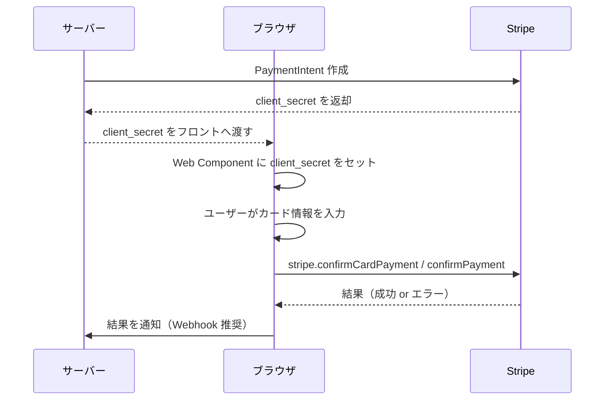
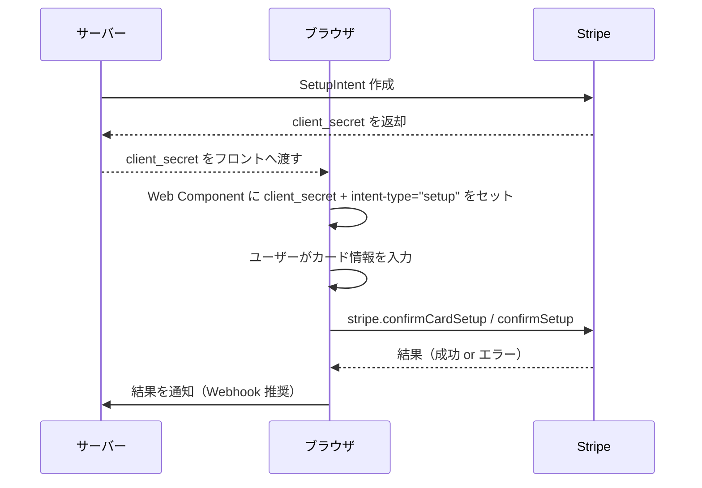
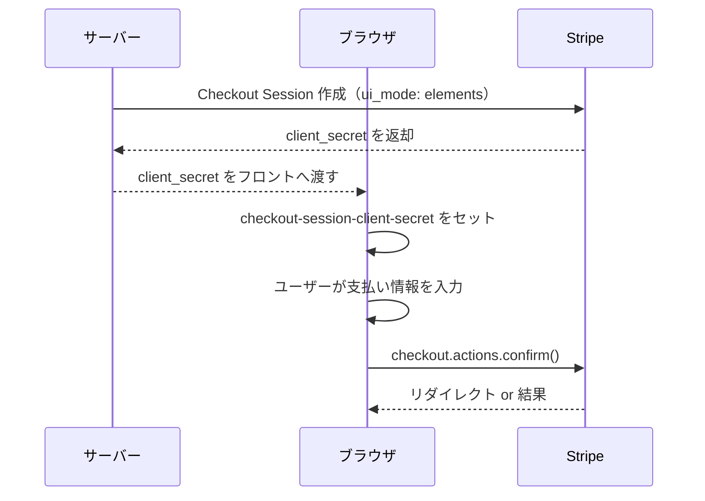
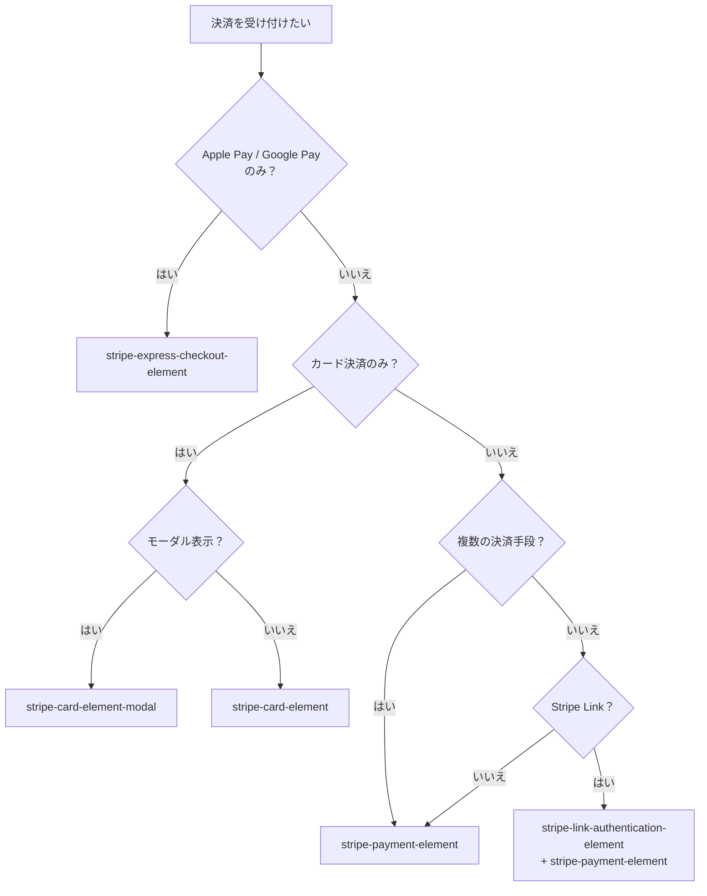

このガイドでは、stripe-pwa-elements で使用する主要な決済フローを説明します。

## PaymentIntent フロー

即時決済を行う場合に使用します。`<stripe-card-element>` または `<stripe-payment-element>` で利用できます。



### コード例

```html
<stripe-payment-element
  publishable-key="pk_test_xxxxx"
  intent-client-secret="pi_xxxxx_secret_xxxxx"
></stripe-payment-element>
```

```js
const el = document.querySelector('stripe-payment-element');
el.addEventListener('defaultFormSubmitResult', ({ detail }) => {
  if (detail instanceof Error) {
    console.error(detail);
  } else {
    console.log('Success:', detail);
  }
});
```

## SetupIntent フロー

将来の決済のためにカード情報を保存する場合に使用します。`intent-type="setup"` を指定します。



### コード例

```html
<stripe-card-element
  publishable-key="pk_test_xxxxx"
  intent-client-secret="seti_xxxxx_secret_xxxxx"
  intent-type="setup"
></stripe-card-element>
```

## Checkout Session フロー

Stripe Checkout の Elements モード（`ui_mode: 'elements'`）を使ったフローです。`<stripe-payment-element>` と`<stripe-payment-sheet>`が Checkout Session の client secret（`cs_xxxxx_secret_xxxxx`）に対応しています。



### コード例

```html
<stripe-payment-element
  publishable-key="pk_test_xxxxx"
  checkout-session-client-secret="cs_xxxxx_secret_xxxxx"
  checkout-session-return-url="https://example.com/return"
  checkout-session-email="customer@example.com"
></stripe-payment-element>
```

- `checkout-session-client-secret`を設定すると Checkout Session モードで初期化されます。`intent-client-secret`とは同時に設定しません。
- 戻り先は、Session 作成時の`return_url`と`checkout-session-return-url`（省略時は現在のページ URL）のどちらか一方が使われます。Session 作成時に`return_url`を設定している場合はそちらが優先され、コンポーネントが自動で切り替えるため、どちらの作り方でも動作します。
- `customer_email`/`customer`を指定せずに作成した Session では、確認時にメールアドレスが必須です。`checkout-session-email`で渡してください（`<stripe-payment-sheet>`では`options.defaultBillingDetails.email`）。
- メールアドレスや住所のプリフィルは`checkoutSessionDefaultValues`（JavaScript プロパティ）で指定できます。`<stripe-payment-sheet>`では`options.defaultBillingDetails`が同じ役割を果たします。
- 結果は`checkoutSessionConfirmResult`イベント（`<stripe-payment-sheet>`では`paymentSheetCompleted`）で受け取れます。

```js
const el = document.querySelector('stripe-payment-element');
el.addEventListener('checkoutSessionConfirmResult', ({ detail }) => {
  console.log(detail instanceof Error ? detail.message : detail.type);
});
```

## コンポーネント選択ガイド

用途に応じて最適なコンポーネントを選択してください。



| コンポーネント | ユースケース |
| --- | --- |
| `stripe-card-element` | カード決済のみ（カード番号・有効期限・CVC を個別表示） |
| `stripe-card-element-modal` | カード決済をモーダルで表示 |
| `stripe-payment-element` | 複数の決済手段を統合表示（カード・銀行振込・ウォレットなど） |
| `stripe-express-checkout-element` | Apple Pay / Google Pay / Link のワンクリック決済 |
| `stripe-link-authentication-element` | Stripe Link によるメール認証 |
| `stripe-address-element` | 住所の収集 |
| `stripe-currency-selector` | Adaptive Pricing の通貨選択 |

## 次に読む

- 各コンポーネントの詳細は [Components](/components/) を参照
- 基本的なセットアップは [Getting Started](/guides/getting-started/) を参照
