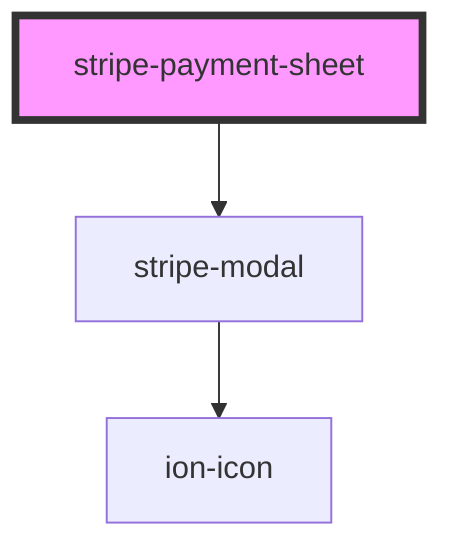

# stripe-payment-sheet

<!-- Auto Generated Below -->

## Overview

A payment sheet: the Payment Element in a modal, with the same events and results as the native PaymentSheet
of `@capacitor-community/stripe`. PaymentIntent and SetupIntent are told apart by the client secret prefix.

## Properties

| Property             | Attribute              | Description                                                                                                                                                                 | Type                                                                                                                                                                                                                                                                                                                                                                                                                                                                                                                                                                                                                                                                                                                                                                                                                                                                             | Default                          |
| -------------------- | ---------------------- | --------------------------------------------------------------------------------------------------------------------------------------------------------------------------- | -------------------------------------------------------------------------------------------------------------------------------------------------------------------------------------------------------------------------------------------------------------------------------------------------------------------------------------------------------------------------------------------------------------------------------------------------------------------------------------------------------------------------------------------------------------------------------------------------------------------------------------------------------------------------------------------------------------------------------------------------------------------------------------------------------------------------------------------------------------------------------- | -------------------------------- |
| `applicationName`    | `application-name`     | Application name registered to Stripe.js, for wrapper libraries such as `@capacitor-community/stripe`.                                                                      | `string`                                                                                                                                                                                                                                                                                                                                                                                                                                                                                                                                                                                                                                                                                                                                                                                                                                                                         | `'stripe-pwa-elements'`          |
| `buttonLabel`        | `button-label`         | Submit button label. Translated automatically by this library.                                                                                                              | `string`                                                                                                                                                                                                                                                                                                                                                                                                                                                                                                                                                                                                                                                                                                                                                                                                                                                                         | `'Pay'`                          |
| `intentClientSecret` | `intent-client-secret` | The client secret of a PaymentIntent (`pi_..._secret_...`) or a SetupIntent (`seti_..._secret_...`). The prefix decides whether `confirmPayment` or `confirmSetup` is used. | `string`                                                                                                                                                                                                                                                                                                                                                                                                                                                                                                                                                                                                                                                                                                                                                                                                                                                                         | `undefined`                      |
| `open`               | `open`                 | Whether the sheet is shown. Setting it to false closes the sheet as canceled.                                                                                               | `boolean`                                                                                                                                                                                                                                                                                                                                                                                                                                                                                                                                                                                                                                                                                                                                                                                                                                                                        | `false`                          |
| `options`            | --                     | Options with the same keys as `CreatePaymentSheetOption` of `@capacitor-community/stripe`. JavaScript property only.                                                        | `{ merchantDisplayName?: string; paymentMethodLayout?: "horizontal" \| "vertical" \| "automatic"; defaultBillingDetails?: { email?: string; name?: string; phone?: string; address?: PaymentSheetAddress; }; returnURL?: string; style?: "alwaysLight" \| "alwaysDark"; billingDetailsCollectionConfiguration?: { email?: "never" \| "always" \| "automatic"; name?: "never" \| "always" \| "automatic"; phone?: "never" \| "always" \| "automatic"; address?: "never" \| "automatic" \| "full"; }; shippingDetails?: { name?: string; phone?: string; address?: PaymentSheetAddress; }; enableApplePay?: boolean; enableGooglePay?: boolean; customerId?: string; customerEphemeralKeySecret?: string; applePayMerchantId?: string; GooglePayIsTesting?: boolean; countryCode?: string; currencyCode?: string; withZipCode?: boolean; allowsDelayedPaymentMethods?: boolean; }` | `undefined`                      |
| `publishableKey`     | `publishable-key`      | Your Stripe publishable API key.                                                                                                                                            | `string`                                                                                                                                                                                                                                                                                                                                                                                                                                                                                                                                                                                                                                                                                                                                                                                                                                                                         | `undefined`                      |
| `sheetTitle`         | `sheet-title`          | Sheet title. Translated automatically by this library.                                                                                                                      | `string`                                                                                                                                                                                                                                                                                                                                                                                                                                                                                                                                                                                                                                                                                                                                                                                                                                                                         | `'Add your payment information'` |
| `stripeAccount`      | `stripe-account`       | Optional. Making API calls for connected accounts                                                                                                                           | `string`                                                                                                                                                                                                                                                                                                                                                                                                                                                                                                                                                                                                                                                                                                                                                                                                                                                                         | `undefined`                      |

## Events

| Event                      | Description                                                                             | Type                                                                                                                                                                                                                              |
| -------------------------- | --------------------------------------------------------------------------------------- | --------------------------------------------------------------------------------------------------------------------------------------------------------------------------------------------------------------------------------- |
| `paymentSheetCanceled`     | The customer closed the sheet                                                           | `CustomEvent<void>`                                                                                                                                                                                                               |
| `paymentSheetCompleted`    | The payment or setup succeeded                                                          | `CustomEvent<{ paymentIntent: PaymentIntent; error?: undefined; } \| { paymentIntent?: undefined; error: StripeError; } \| { setupIntent: SetupIntent; error?: undefined; } \| { setupIntent?: undefined; error: StripeError; }>` |
| `paymentSheetFailed`       | The confirmation failed with an error the customer cannot fix in the sheet              | `CustomEvent<unknown>`                                                                                                                                                                                                            |
| `paymentSheetFailedToLoad` | Stripe.js or the Payment Element failed to load, or the client secret format is unknown | `CustomEvent<unknown>`                                                                                                                                                                                                            |
| `paymentSheetLoaded`       | Stripe.js and the Payment Element are ready                                             | `CustomEvent<{ stripe: Stripe; }>`                                                                                                                                                                                                |

## Methods

### `present() => Promise<PaymentSheetPresentResult>`

Show the sheet and wait for its result.
Calling it again while a result is pending returns the same promise.

#### Returns

Type: `Promise<PaymentSheetPresentResult>`

`{ paymentResult }`, where `paymentResult` is `paymentSheetCompleted`, `paymentSheetCanceled` or `paymentSheetFailed`

## Dependencies

### Depends on

- [stripe-modal](../stripe-modal)

### Graph

---

_Built with [StencilJS](https://stenciljs.com/)_
